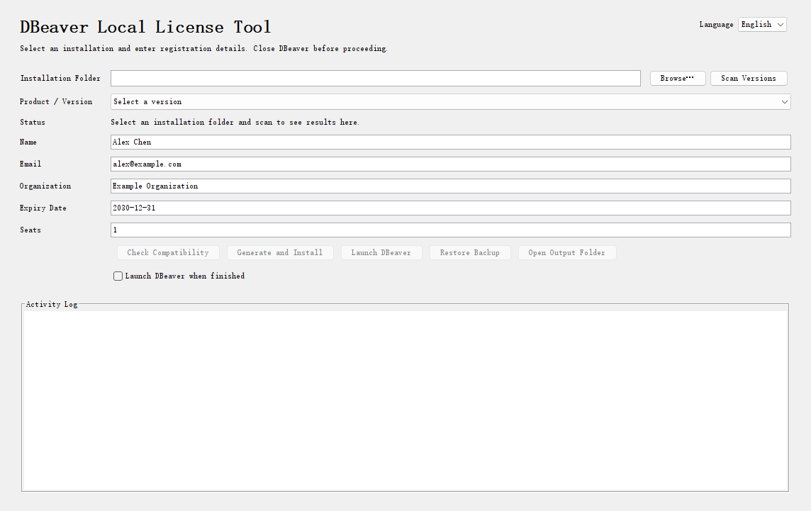

# DBeaver Local License Tool

English | [简体中文](README.zh-CN.md)

A Java desktop and command-line tool for selecting a DBeaver installation, generating and importing registration details, and restoring backups.



*English interface with example registration details.*

## Quick start

Requires **Java 21+**. Extract the portable ZIP and open the launcher for your system:

| System | Launcher |
| --- | --- |
| Windows | `run.cmd` |
| macOS | `run.command` |
| Linux | `./run.sh` |

If needed, run `chmod +x run.sh run.command`. Set `JAVA_HOME` or `JAVA_CMD` if Java is not found.

1. Close DBeaver, select its installation folder, and scan for versions.
2. Select a compatible version and enter your name, email, organization, expiry date, and seat count.
3. Click **Generate and Install**. Once import is verified, start DBeaver using its usual shortcut.

Use the same user account and data-directory settings for the tool and DBeaver. The **Language** menu switches between English and Chinese and remembers your choice. First launch follows the system language: Chinese for Chinese locales, English otherwise.

## Build

From the source directory, with **JDK 21+**:

```sh
java Build.java
```

Output: `dist/dbeaver-license-tool-portable.zip`.

Build checks: `java tests/BuildTest.java`.

## Automated builds and releases

Pushes to `main`, pull requests targeting `main`, and manual runs check the build on Windows, macOS, and Linux. Download the ZIP from the workflow's artifacts, retained for 7 days.

Push a version tag to publish a GitHub Release with the ZIP and generated release notes after the checks pass:

```sh
git tag v1.0.0
git push origin v1.0.0
```

## Command line

From the extracted package directory:

```sh
java -jar dbeaver-license-tool.jar --help
```

Commands: `scan`, `inspect`, `activate`, `restore`. Use `--lang en` or `--lang zh` to override the language for one run.

## Restore

Click **Restore Backup** for the selected installation. Keep its `.local-license-tool/<product>/` directory: it contains the original files and recovery information. Restore recovers the previous plugins and registration record.

## Compatibility

Compatibility is checked against the selected installation; not every version is supported. Validation used Windows and an Enterprise 26.2.0.1 sample. Native macOS/Linux execution and full DBeaver GUI acceptance remain unverified.

## Disclaimer

- This is an independent project intended for learning, technical research, and authorized testing. It is not affiliated with, endorsed by, or sponsored by DBeaver Corp.
- Using this tool or generating registration information does not grant a commercial software license or replace the rights holder’s authorization. Users are responsible for ensuring their use complies with applicable laws and software license terms.
- The tool may modify local application files and registration data. Back up your installation and data before use. Compatibility, uninterrupted operation, and recovery are not guaranteed.
- The project is provided “as is,” without warranties. To the extent permitted by applicable law, the authors and contributors are not liable for losses arising from its use. Rights in third-party software and trademarks remain with their respective owners.
