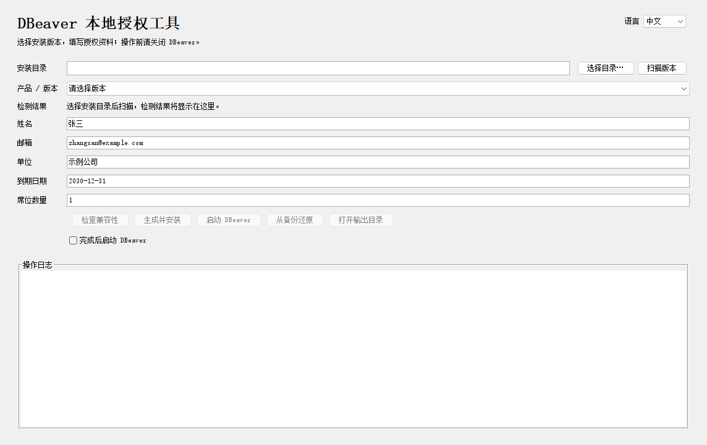

# DBeaver 本地授权工具

[English](README.md) | 简体中文

基于 Java 的桌面及命令行工具，可选择 DBeaver 安装版本、生成并导入注册信息，以及从备份还原。



*中文界面，注册资料为示例。*

## 快速开始

需要 **Java 21+**。解压便携 ZIP 后，运行对应系统的启动脚本：

| 系统 | 启动脚本 |
| --- | --- |
| Windows | `run.cmd` |
| macOS | `run.command` |
| Linux | `./run.sh` |

若缺少执行权限，运行 `chmod +x run.sh run.command`。找不到 Java 时可设置 `JAVA_HOME` 或 `JAVA_CMD`。

1. 关闭 DBeaver，选择安装目录并扫描版本。
2. 选择兼容的版本，填写姓名、邮箱、单位、到期日期和席位数。
3. 点击 **生成并安装**。导入验证成功后，使用原来的快捷方式启动 DBeaver。

工具与 DBeaver 应使用相同的用户账户和数据目录设置。右上角的 **语言** 菜单可切换中英文并记住选择。首次启动跟随系统语言：中文系统使用中文，其余系统使用英文。

## 构建

在源码目录中使用 **JDK 21+** 执行：

```sh
java Build.java
```

构建产物：`dist/dbeaver-license-tool-portable.zip`。

构建检查：`java tests/BuildTest.java`。

## 自动构建与发布

推送到 `main`、向 `main` 提交 PR 或手动运行工作流，会在 Windows、macOS 和 Linux 上执行构建检查。ZIP 可从工作流的构建产物中下载，保留 7 天。

推送版本标签后，检查通过即自动创建 GitHub Release，上传 ZIP 并生成更新说明：

```sh
git tag v1.0.0
git push origin v1.0.0
```

## 命令行

在解压后的发行目录中执行：

```sh
java -jar dbeaver-license-tool.jar --help
```

提供 `scan`、`inspect`、`activate`、`restore` 命令。使用 `--lang en` 或 `--lang zh` 临时指定本次运行的语言。

## 还原

选择对应安装后点击 **从备份还原**。请保留安装目录下的 `.local-license-tool/<product>/`，其中存放原文件和恢复信息。还原会恢复此前的插件和注册记录。

## 兼容性

兼容性以所选安装的检测结果为准，并非支持所有版本。验证使用 Windows 和 Enterprise 26.2.0.1 样本；macOS/Linux 原生运行及完整 DBeaver 图形界面验收仍未验证。

## 免责声明

- 本项目为独立项目，仅用于学习、技术研究及获授权的测试，与 DBeaver Corp 无隶属关系，亦未获得其认可或赞助。
- 使用本工具或生成注册信息，不代表取得商业软件许可证，也不替代权利人的授权。使用者应自行确保使用行为符合适用法律及相关软件许可条款。
- 本工具可能修改本地程序文件和注册数据。使用前请备份安装目录及相关数据；项目不保证兼容性、持续可用性或恢复结果。
- 本项目按“现状”提供，不作任何保证。在适用法律允许的范围内，作者及贡献者不对使用本项目产生的损失承担责任。第三方软件及商标的相关权利归各自权利人所有。
